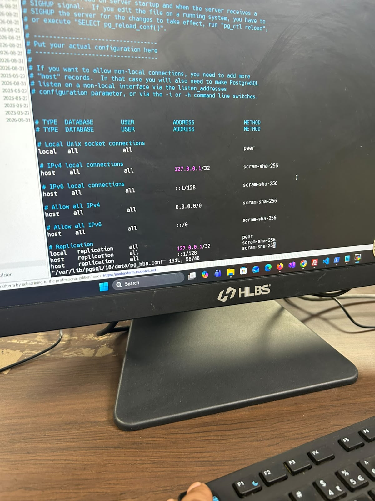

# DB Access Request — PostgreSQL `pg_hba.conf` (BBMB)

**Kis ke liye:** DB / server admin (jiske paas PostgreSQL server `10.44.81.237` ka access hai)
**Kisne maanga:** Manish Kumar
**Date:** 2026-10-19

---

## Problem (ek line mein)

VPN se DB server tak **network pahunch ban rahi hai** (`10.44.81.237:5432` TCP succeeded),
par PostgreSQL **login par reject kar raha hai** kyunki mere VPN client IP ke liye
`pg_hba.conf` mein koi entry nahi hai. Migrations chalane ke liye access chahiye.

Error jo aa raha hai:

```
FATAL: no pg_hba.conf entry for host "172.16.11.95", user "postgres", database "BBMB", no encryption
```

> Note: VPN client IP har reconnect par badalta hai — ab tak `172.16.11.93`,
> `172.16.11.95`, aur `10.147.8.85` dekhe gaye. Isliye **single IP nahi, poora
> VPN pool range** allow karna zaroori hai.

---

## Request — ye 2 steps karein (server `10.44.81.237` par)

### 1. `pg_hba.conf` mein ye lines add karein

```
# BBMB — VPN clients (AnyConnect pool) ko BudgetService migrations ke liye allow
host    BBMB    postgres    172.16.10.0/23    md5
host    BBMB    postgres    10.147.0.0/16     md5
```

- `172.16.10.0/23` → `172.16.10.x` + `172.16.11.x` dono cover karta hai (mera current VPN IP yahin aata hai).
- `10.147.0.0/16` → ek aur VPN pool jo kabhi-kabhi assign hota hai.
- Server SSL support nahi karta (test mein `server does not support SSL` aaya), isliye
  `md5` theek hai; `hostssl` ki zaroorat nahi.

### 2. Config reload karein (restart ki zaroorat nahi)

```sql
SELECT pg_reload_conf();
```

ya shell se:

```bash
pg_ctl reload        # (ya: sudo systemctl reload postgresql)
```

---

## Verify (reload ke baad)

Mera VPN IP range `pg_hba` mein aa gaya ya nahi — ek check:

```sql
SELECT type, database, user_name, address, auth_method
FROM pg_hba_file_rules
WHERE database::text LIKE '%BBMB%' OR address IN ('172.16.10.0', '10.147.0.0');
```

---

## Reference — mere connection ki details (admin ke liye)

| Item | Value |
|---|---|
| DB server (VPN se) | `10.44.81.237` |
| DB server (office LAN se) | `10.43.18.13` *(ye dono ek hi server hain? — confirm kar dein)* |
| Port | `5432` |
| Database | `BBMB` |
| User | `postgres` |
| My VPN client IP (abhi) | `172.16.11.95` (badalta rehta hai) |
| VPN pool | `172.16.10.0/23` |
| SSL | server par OFF hai |

---

## Ek confirmation bhi chahiye

Kya **`10.44.81.237` (VPN) aur `10.43.18.13` (office LAN) ek hi PostgreSQL server
hain** (bas do network paths ke do IP), ya ye **do alag server** hain?

Ye isliye zaroori hai — migration asli `BBMB` data wale server par hi chalni chahiye.
Agar `10.44.81.237` koi alag/replica/test server hua, to batayein, taaki galat DB par
migration na chale.

---

*Access milte hi migrations (BudgetService, actor-gated EF update) chala di jayengi —
procedure `MIGRATION-RUN-INSTRUCTIONS.md` mein hai.*
